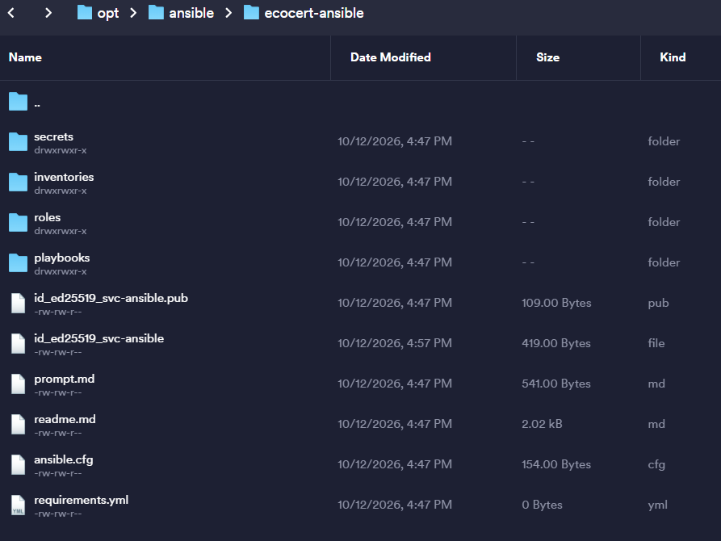

# Configuration d'Ansible sur le serveur de centralisation


---

> [!note] "Informations"
>
> - **Auteur :** Louis MEDO
> - **Date :** 19/10/2026
> - **Domaine :** Debian

---

## 1. Sommaire

- [1. Sommaire](#1-sommaire)
- [2. Contexte](#2-contexte)
- [3. Préparation de l'environnement](#3-preparation-de-lenvironnement)
- [4. Récupération des sources et des secrets](#4-recuperation-des-sources-et-des-secrets)
- [5. Exécution du premier déploiement](#5-execution-du-premier-deploiement)

## 2. Contexte

Mise en place de l'environnement Ansible sur le serveur de centralisation **CONFECOCERT**. Ce service permet d'automatiser la configuration et le déploiement des postes clients de l'infrastructure via une approche Infrastructure as Code (IaC), assurant ainsi une standardisation et une gestion centralisée du parc informatique.

## 3. Préparation de l'environnement {#3-preparation-de-lenvironnement}

3.1. **Création du répertoire cible.** Mise en place et configuration des droits sur le dossier hébergeant l'IaC.

```bash
sudo mkdir /opt/ansible
sudo chown etudiant:etudiant -R /opt/ansible
```

- `sudo mkdir /opt/ansible` : Crée le répertoire racine pour Ansible en tant que super-utilisateur.
- `sudo chown etudiant:etudiant -R` : Change récursivement (`-R`) le propriétaire et le groupe du répertoire au profit du compte `etudiant` pour la gestion des droits.

## 4. Récupération des sources et des secrets {#4-recuperation-des-sources-et-des-secrets}

4.1. **Clonage du dépôt Git.** Récupération et mise à jour des playbooks Ansible.

```bash
cd /opt/ansible
git clone https://github.com/FireToak/ecocert-ansible.git
cd ecocert-ansible
```

- `git clone` : Télécharge le dépôt distant en local sur le serveur.
- `cd ecocert-ansible` : Navigue dans le répertoire cloné.

4.2. **Importation de la clé SSH Ansible.** Sécurisation de l'accès vers les machines cibles.

> [!warning] "Attention à la sécurité des secrets"
> Récupérez la clé privée SSH de service d'Ansible dans le gestionnaire de mots de passe Bitwarden. Placez-la à la racine du dépôt git. Ce fichier est volontairement ignoré par le gestionnaire de versions (fichier `.gitignore`).

**Protéger la clé privée :**

```bash
chmod 700 id_ed25519_svc-ansible
```

- `chmod 700` : Applique les droits stricts de lecture, d'écriture et d'exécution uniquement au propriétaire du fichier, empêchant l'accès à la clé privée par d'autres utilisateurs.

**Exemple de résultat attendu :**



## 5. Exécution du premier déploiement {#5-execution-du-premier-deploiement}

5.1. **Lancement du playbook de bootstrap.** Application de la configuration de base sur les postes.

```bash
ansible-playbook -i inventories/production/hosts.yml playbooks/pc-bootstrap.yml -K
```

- `ansible-playbook` : Binaire utilisé pour exécuter les scénarios Ansible (playbooks).
- `-i inventories/production/hosts.yml` : Définit le chemin ciblant le fichier d'inventaire de l'environnement de production.
- `playbooks/pc-bootstrap.yml` : Spécifie le playbook exact à jouer sur les hôtes.
- `-K` : Argument demandant la saisie interactive du mot de passe `sudo` (become) requis pour élever les privilèges sur les postes de destination lors du premier lancement.
