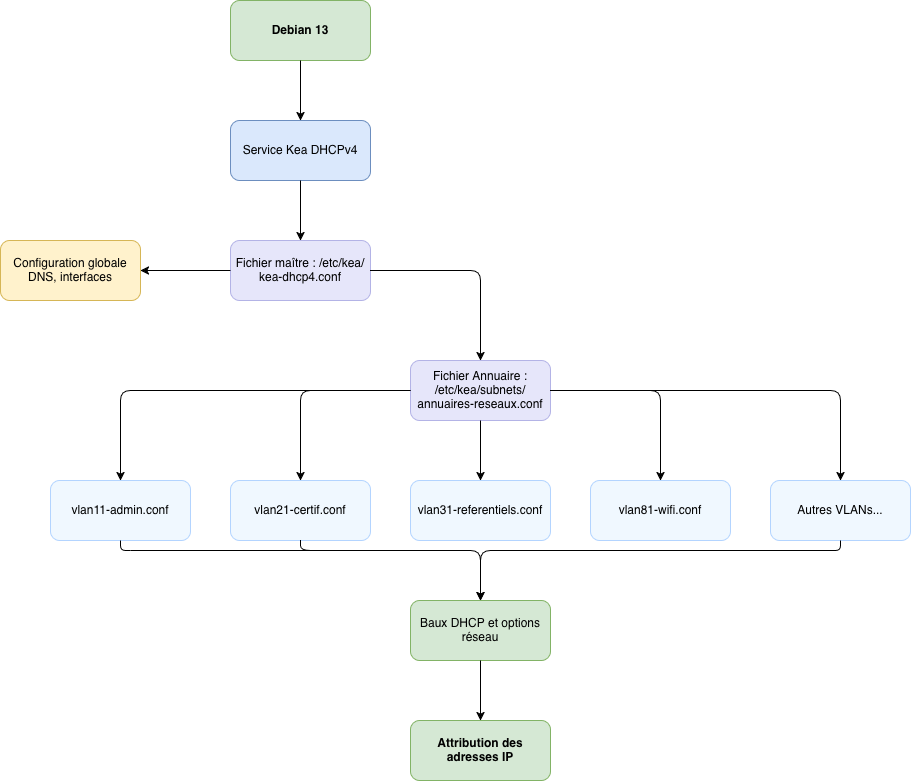

# Déploiement et Sécurisation de l'Architecture Modulaire Kea DHCPv4


---

!!! note "Informations"

    - **Auteur :** Amine KADA
    - **Date :** 12/10/2026
    - **Domaine :** Debian 13

---

## 1. Sommaire

- [1. Sommaire](#1-sommaire)
- [2. Contexte](#2-contexte)
- [3. Configuration Globale (Fichier Maître)](#3-configuration-globale-fichier-maitre)
- [4. Création de l'Index d'Inclusion](#4-creation-de-lindex-dinclusion)
- [5. Définition des Sous-Réseaux (VLANs)](#5-definition-des-sous-reseaux-vlans)
- [6. Application des Permissions (Sécurisation des accès)](#6-application-des-permissions-securisation-des-acces)
- [7. Dérogation de sécurité AppArmor](#7-derogation-de-securite-apparmor)
- [8. Validation et Déploiement](#8-validation-et-deploiement)

---

## 2. Contexte

Le service Kea DHCPv4 est le composant central d'attribution IP de l'infrastructure ECOCERT. Cette procédure documente la transition vers une architecture modulaire en cascade (*Top-Down*) utilisant un fichier d'indexation. Elle intègre le durcissement du service (mode *Authoritative*), la redondance DNS, la ségrégation des sous-réseaux par VLAN, la gestion fine des permissions système et le confinement AppArmor, conformément aux standards d'ingénierie de production.

---

## 3. Configuration Globale (Fichier Maître)

3.1. **Définition des paramètres de base et de sécurité.** Édition du fichier maître pour configurer l'interface d'écoute, la redondance DNS, forcer l'autorité du serveur, définir l'inclusion de l'annuaire et activer les journaux d'événements.



```json title="/etc/kea/kea-dhcp4.conf" hl_lines="4 14-17 21 24-32"
{
    "Dhcp4": {
        "interfaces-config": {
            "interfaces": [ "ens18" ]
        },
        "control-socket": {
            "socket-type": "unix",
            "socket-name": "/run/kea/kea-dhcp4-ctrl.sock"
        },
        "lease-database": {
            "type": "memfile",
            "lfc-interval": 3600
        },
        "valid-lifetime": 4000,
        "authoritative": true,
        "option-data": [
            {
                "name": "domain-name-servers",
                "data": "172.16.54.1, 1.1.1.1"
            },
            {
                "name": "domain-name",
                "data": "local.ecocert4.fr"
            }
        ],
        "subnet4": [
            <?include "/etc/kea/subnets/annuaires-reseaux.conf"?>
        ],
        "loggers": [
            {
                "name": "kea-dhcp4",
                "output-options": [
                    { "output": "/var/log/kea/kea-dhcp4.log", "maxsize": 10485760, "maxver": 5 }
                ],
                "severity": "INFO"
            }
        ]
    }
}
```

- `ens18` : Interface réseau d'écoute du service DHCP.
- `authoritative` : Permet au serveur de répondre par un DHCPNAK aux requêtes non valides, assainissant le trafic réseau.
- `domain-name-servers` : Déclaration du contrôleur AD local et d'un résolveur public en secours (Failover).
- `<?include ... ?>` : Directive de préprocesseur ciblant le fichier d'indexation des sous-réseaux.
- `loggers` : Configuration de la journalisation avec rotation automatique (10 Mo, 5 archives maximum).

---

## 4. Création de l'Index d'Inclusion

4.1. **Centralisation des configurations réseaux.** Création du fichier annuaire agissant comme unique point d'entrée pour les sous-réseaux.

```text title="/etc/kea/subnets/annuaires-reseaux.conf"
<?include "/etc/kea/subnets/vlan11-admin.conf"?>,
<?include "/etc/kea/subnets/vlan21-certif.conf"?>,
<?include "/etc/kea/subnets/vlan31-referentiels.conf"?>,
<?include "/etc/kea/subnets/vlan41-formapro.conf"?>,
<?include "/etc/kea/subnets/vlan61-conseiltech.conf"?>,
<?include "/etc/kea/subnets/vlan71-techniques.conf"?>,
<?include "/etc/kea/subnets/vlan81-wifi.conf"?>
```

> [!warning] Syntaxe stricte JSON
> La dernière ligne du fichier annuaire ne doit **jamais** comporter de virgule finale afin de maintenir l'intégrité de la structure du tableau JSON généré en mémoire lors de l'assemblage.

---

## 5. Définition des Sous-Réseaux (VLANs)

5.1. **Matrice des sous-réseaux de l'infrastructure.** Chaque sous-réseau est isolé dans son propre fichier de configuration au sein du dossier `/etc/kea/subnets/`.

| Fichier | VLAN ID | Sous-réseau | Masque | Passerelle (Routeur) | Plage dynamique (Pool) |
| :--- | :--- | :--- | :--- | :--- | :--- |
| `vlan11-admin.conf` | `11` | `192.168.4.0/26` | `255.255.255.192` | `192.168.4.62` | `192.168.4.10 - 192.168.4.60` |
| `vlan21-certif.conf` | `21` | `192.168.4.64/27` | `255.255.255.224` | `192.168.4.94` | `192.168.4.70 - 192.168.4.90` |
| `vlan31-referentiels.conf` | `31` | `192.168.4.160/27` | `255.255.255.224` | `192.168.4.190` | `192.168.4.165 - 192.168.4.185` |
| `vlan41-formapro.conf` | `41` | `192.168.4.208/28` | `255.255.255.240` | `192.168.4.222` | `192.168.4.212 - 192.168.4.220` |
| `vlan61-conseiltech.conf` | `61` | `192.168.4.128/27` | `255.255.255.224` | `192.168.4.158` | `192.168.4.135 - 192.168.4.150` |
| `vlan71-techniques.conf` | `71` | `192.168.4.192/28` | `255.255.255.240` | `192.168.4.206` | `192.168.4.195 - 192.168.4.200` |
| `vlan81-wifi.conf` | `81` | `192.168.4.96/27` | `255.255.255.224` | `192.168.4.126` | `192.168.4.100 - 192.168.4.120` |

5.2. **Structure type d'un bloc de sous-réseau.** Exemple appliqué au VLAN 11 (Administration) :

```json title="/etc/kea/subnets/vlan11-admin.conf"
{
    "id": 11,
    "subnet": "192.168.4.0/26",
    "pools": [ { "pool": "192.168.4.10 - 192.168.4.60" } ],
    "option-data": [
        { "name": "routers", "data": "192.168.4.62" }
    ],
    "user-context": { "description": "VLAN 11 - Administration" }
}
```

- `id` : Identifiant forcé correspondant au numéro du VLAN, indispensable pour l'observabilité et la haute disponibilité.
- `routers` : Distribue l'adresse IP de la passerelle par défaut (interface virtuelle du commutateur L3) aux clients du sous-réseau.

---

## 6. Application des Permissions (Sécurisation des accès)

6.1. **Sécurisation de l'arborescence de configuration.** Définir les propriétaires et les droits d'accès pour concilier le principe de moindre privilège du compte de service `_kea` et la traversée par les commandes d'administration `root`.

```bash
# Permissions du dossier racine et du fichier maître
sudo chown root:_kea /etc/kea
sudo chmod 755 /etc/kea
sudo chmod 644 /etc/kea/kea-dhcp4.conf

# Permissions du sous-dossier et des blocs d'inclusion
sudo chown -R root:_kea /etc/kea/subnets
sudo chmod 755 /etc/kea/subnets
sudo chmod 644 /etc/kea/subnets/*
```

- `root:_kea` : Assure la propriété d'administration à `root` tout en garantissant l'appartenance au groupe de service `_kea`.
- `755 / 644` : Permet à `root` (lors de l'exécution de `sudo kea-dhcp4 -t`) et à l'utilisateur de service `_kea` de parcourir et lire l'ensemble des fichiers sans déclencher de refus de droit d'accès (*DAC violation*).

6.2. **Création et sécurisation du dossier des journaux.** Assurer les droits d'écriture pour la rotation des logs gérés par le service.

```bash
sudo mkdir -p /var/log/kea
sudo chown _kea:_kea /var/log/kea
sudo chmod 755 /var/log/kea
```

---

## 7. Dérogation de sécurité AppArmor

7.1. **Mise à jour du profil de sécurité du noyau.** Par défaut, le profil AppArmor de Kea confine strictement le binaire `/usr/sbin/kea-dhcp4` et interdit la lecture des sous-répertoires personnalisés ainsi que l'utilisation des capacités d'outrepassement DAC.

Éditer le fichier de surcharge locale :

```bash
sudo nano /etc/apparmor.d/local/usr.sbin.kea-dhcp4
```

Ajouter l'ensemble des directives d'autorisation :

```text title="/etc/apparmor.d/local/usr.sbin.kea-dhcp4"
# Autoriser les capacités de recherche et de lecture DAC
capability dac_override,
capability dac_read_search,

# Autoriser la lecture récursive de l'arborescence et des inclusions
/etc/kea/** r,

# Autoriser les sockets et fichiers de verrouillage
/run/kea/** rwk,

# Autoriser les journaux personnalisés
/var/log/kea/** rwk,
```

- `capability dac_override, dac_read_search` : Permet aux commandes de test invoquées avec `sudo` de lire les fichiers de configuration sans être bloquées au niveau du noyau.
- `/etc/kea/** r,` : Autorise la lecture récursive des inclusions situées dans `/etc/kea/subnets/`.
- `/run/kea/** rwk,` : Permet la création des sockets de communication et des verrous PID.
- `/var/log/kea/** rwk,` : Permet la création, l'écriture et la rotation des journaux d'événements.

7.2. **Rechargement du profil.** Recharger le profil dans le noyau Linux pour appliquer immédiatement les dérogations :

```bash
sudo apparmor_parser -r /etc/apparmor.d/usr.sbin.kea-dhcp4
```

---

## 8. Validation et Déploiement

8.1. **Vérification syntaxique globale.** Valider l'intégrité du fichier maître et l'ensemble de ses 7 inclusions JSON :

```bash
sudo kea-dhcp4 -t /etc/kea/kea-dhcp4.conf
```

> [!important] Syntaxe de commande Kea
> L'option `-t <fichier>` prend directement le chemin du fichier de configuration en argument. Ne pas associer `-t` et `-c` car ce sont deux options mutuellement exclusives.

Le retour attendu doit confirmer l'ajout de chacun des 7 sous-réseaux et l'écoute sur l'interface :
```text
INFO  [kea-dhcp4.dhcpsrv] DHCPSRV_CFGMGR_NEW_SUBNET4 a new subnet has been added to configuration: 192.168.4.0/26 ...
INFO  [kea-dhcp4.dhcpsrv] DHCPSRV_CFGMGR_NEW_SUBNET4 a new subnet has been added to configuration: 192.168.4.64/27 ...
...
INFO  [kea-dhcp4.dhcpsrv] DHCPSRV_CFGMGR_ADD_IFACE listening on interface ens18
```

8.2. **Redémarrage et supervision du service.** Application de la configuration en production :

```bash
sudo systemctl restart kea-dhcp4-server
sudo systemctl status kea-dhcp4-server
```

Pour visualiser l'attribution des baux et les séquences DORA en direct :

```bash
sudo tail -f /var/log/kea/kea-dhcp4.log
# ou
sudo journalctl -u kea-dhcp4-server -n 25 --no-pager
```

---

*[Documentation officielle Kea DHCPv4 Server](https://kea.readthedocs.io/en/stable/arm/dhcp4-srv.html)*