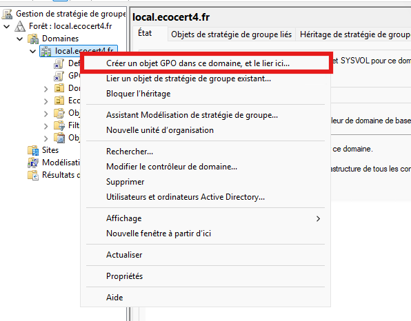
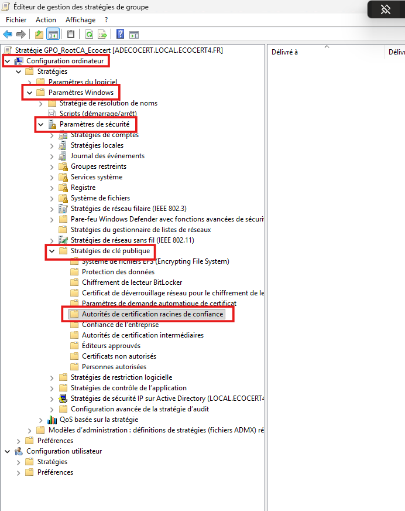
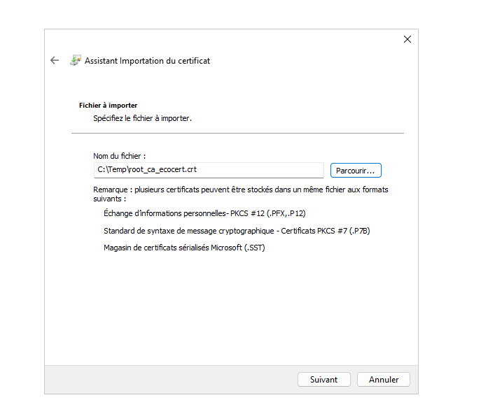
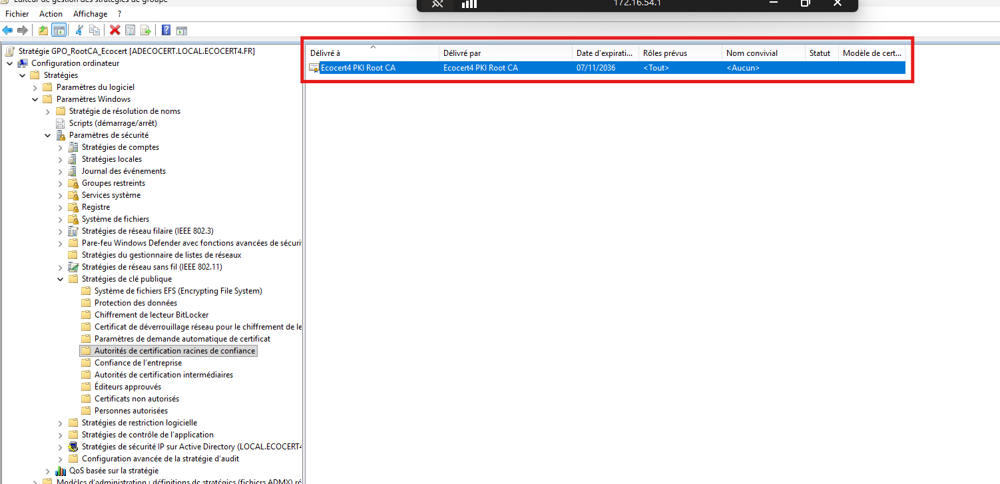

# Déploiement du certificat racine via GPO sur Windows


---

> [!note] "Informations"
>
> - **Auteur :** Louis MEDO
> - **Date :** 16/11/2026
> - **Domaine :** Windows

---

## 1. Sommaire

- [1. Sommaire](#1-sommaire)
- [2. Contexte](#2-contexte)
- [3. Récupération et transfert du certificat racine](#3-recuperation-et-transfert-du-certificat-racine)
- [4. Configuration de la stratégie de groupe](#4-configuration-de-la-strategie-de-groupe)
- [5. Application et vérification sur les clients](#5-application-et-verification-sur-les-clients)

## 2. Contexte

Afin de garantir la confiance cryptographique des postes du parc envers les services internes signés par la PKI `step-ca`, le certificat racine (Root CA) doit être déployé globalement. L'utilisation des stratégies de groupe (GPO) permet d'automatiser cette injection dans le magasin système "Autorités de certification racines de confiance". Cette procédure détaille la récupération du certificat depuis un poste d'administration, son transfert sécurisé via RDP vers le contrôleur de domaine, puis son déploiement centralisé.

## 3. Récupération et transfert du certificat racine

3.1. **Téléchargement sur le poste client.** Récupération du certificat public depuis le serveur PKI sur le poste de travail de l'administrateur.

```powershell title="download_root_ca_client.ps1"
Invoke-WebRequest -Uri "https://pki.ecocert4.fr/roots.pem" -OutFile "$env:USERPROFILE\Downloads\root_ca_ecocert.crt"
```

- `Invoke-WebRequest` : Cmdlet effectuant des requêtes HTTP/HTTPS, utilisée ici pour interroger le point de terminaison de la PKI.
- `-Uri` : Spécifie l'URL source où est exposé le certificat racine public.
- `-OutFile` : Spécifie le chemin d'enregistrement local avec l'extension `.crt`, format natif requis par l'assistant d'importation GPO.

3.2. **Transfert vers le serveur via RDP.** Importation manuelle du fichier `.crt` sur le contrôleur de domaine en exploitant la redirection du presse-papiers de la session Bureau à distance.

> [!note] "Prérequis RDP"
> La copie de fichiers via RDP nécessite que l'option **Presse-papiers** soit activée dans l'onglet **Ressources locales** du client Connexion Bureau à distance (`mstsc.exe`) avant d'initier la connexion.

- Depuis l'explorateur de fichiers du poste client, copier le fichier téléchargé `root_ca_ecocert.crt` (Ctrl+C).
- Ouvrir et s'authentifier sur la session RDP vers le contrôleur de domaine de l'infrastructure.
- Coller le fichier (Ctrl+V) dans un répertoire de transit sur le serveur, par exemple `C:\Temp\`.

## 4. Configuration de la stratégie de groupe

4.1. **Création et paramétrage de la GPO.** Définition de la stratégie poussant le certificat sur les postes membres.

- Ouvrir la console de gestion de stratégie de groupe (`gpmc.msc`) sur le contrôleur de domaine.
- Créer et lier une GPO nommée `GPO_RootCA_Ecocert` sur l'Unité d'Organisation (OU) contenant les machines cibles.



- Éditer la GPO et naviguer dans : **Configuration ordinateur** > **Stratégies** > **Paramètres Windows** > **Paramètres de sécurité** > **Stratégies de clé publique** > **Autorités de certification racines de confiance**.



- Faire un clic droit, sélectionner **Importer...**, puis pointer vers le fichier transféré `C:\Temp\root_ca_ecocert.crt`.



> [!warning] "Périmètre d'application"
> La GPO modifie la configuration système globale du poste ("Configuration ordinateur"). Un redémarrage des clients ou une actualisation GPO en arrière-plan est requis pour que l'approbation soit active.

**Exemple de résultat :**



## 5. Application et vérification sur les clients

5.1. **Actualisation des stratégies et validation.** Forcer la récupération de la nouvelle GPO sur un poste client et vérifier l'import effectif du certificat dans le magasin.

```powershell title="verify_gpo.ps1"
gpupdate /force
Get-ChildItem -Path "Cert:\LocalMachine\Root" | Where-Object { $_.Subject -match "Ecocert" }
```

- `gpupdate /force` : Binaire natif forçant le rafraîchissement immédiat de toutes les stratégies de groupe locales et Active Directory.
- `Get-ChildItem` : Cmdlet listant les objets d'un chemin, ciblant ici spécifiquement le magasin cryptographique système (`LocalMachine\Root`).
- `Where-Object` : Filtre les résultats renvoyés pour confirmer la présence du sujet de l'autorité (Ecocert).
