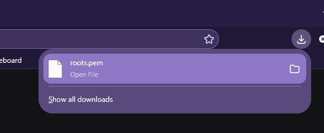

# Déploiement du Certificat Racine manuellement sur Windows


---

> [!note] "Informations"
>
> - **Auteur :** Louis MEDO
> - **Date :** 10/11/2026
> - **Domaine :** Debian

---

## 1. Sommaire

- [1. Sommaire](#1-sommaire)
- [2. Contexte](#2-contexte)
- [3. Récupération du certificat racine](#3-recuperation-du-certificat-racine)
- [4. Vérification de l'empreinte cryptographique](#4-verification-de-lempreinte-cryptographique)
- [5. Importation dans le magasin de certificats Windows](#5-importation-dans-le-magasin-de-certificats-windows)

## 2. Contexte

Afin que les postes clients et serveurs Windows fassent confiance aux services internes (HTTPS, RDP, LDAPS) signés par la PKI Ecocert4, le certificat racine (Root CA) doit être injecté dans le magasin "Autorités de certification racines de confiance" du système. Cette procédure utilise PowerShell afin d'être transposable directement dans un playbook Ansible via les modules `win_shell` ou `win_certificate`.

## 3. Récupération du certificat racine

3.1. **Téléchargement du certificat.** Récupération du fichier public `.pem` directement depuis le point de terminaison web natif de l'autorité de certification, converti en `.crt` localement.

- Ouvrir votre navigateur internet pour vous rendre à l'adresse [pki.ecocert4.fr/roots.pem](https://pki.ecocert4.fr/roots.pem) (Accepter l'avertissement) et téléchargement le certificat root de la PKI local.

**Avertissement de sécurité du navigateur internet :**


**Téléchargement du root CA de la PKI Internet :**



## 4. Vérification de l'empreinte cryptographique

> [!warning] "Intégrité"
> L'installation d'une autorité racine donne un contrôle total sur l'interception des flux (MITM). Il est impératif de valider que le fichier téléchargé correspond cryptographiquement à la PKI légitime avant son importation.
>
> **Hash en SHA256 du certificat racine :**
>
> ```Plaintext
> 71A84C99304E592EF481D7A31E5223E3E988F79C05E8EE4EB12A802DB42AC43C
> ```

4.1. **Calcul de l'empreinte SHA256.** Ouvrir powershell puis vérifier le hash du fichier téléchargé pour le comparer manuellement (ou via une condition Ansible) avec le *Root Fingerprint* original fourni lors de l'initialisation de `step-ca`.

```powershell title="verify_fingerprint.ps1"
cd ~\Downloads
Rename-Item -Path "roots.pem" -NewName "root_ca_ecocert.crt"
(Get-FileHash -Algorithm SHA256 -Path "~\Downloads\root_ca_ecocert.crt").Hash
```

- `-Algorithm` : Force l'utilisation de l'algorithme SHA256, standard utilisé par `step-ca` pour ses empreintes.
- `-Path` : Pointe vers le fichier de certificat fraîchement téléchargé.

## 5. Importation dans le magasin de certificats Windows

> [!warning] "Powershell en tant qu'administrateur"
> Vous devez lancer PowerShell en tant qu'administrateur pour pouvoir ajouter le certificat racine de la PKI.

5.1. **Injection dans le magasin LocalMachine.** Ajout du certificat vérifié au niveau système (pour tous les utilisateurs) dans le conteneur des autorités de certification racines de confiance. L'invite de commande PowerShell doit être exécutée en tant qu'Administrateur.

```powershell title="import_certificate.ps1"
cd ~\Downloads
Rename-Item -Path "roots.pem" -NewName "root_ca_ecocert.crt"
Import-Certificate -FilePath "~\Downloads\root_ca_ecocert.crt" -CertStoreLocation "Cert:\LocalMachine\Root"
```

- `-FilePath` : Chemin absolu vers le certificat racine validé à l'étape précédente.
- `-CertStoreLocation` : Cible le magasin `Root` de la machine locale (`LocalMachine`), garantissant que la confiance s'applique au système entier et non au profil utilisateur courant.
