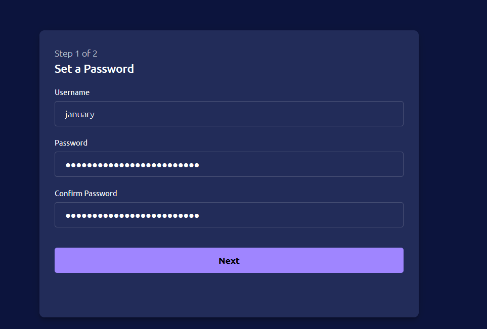
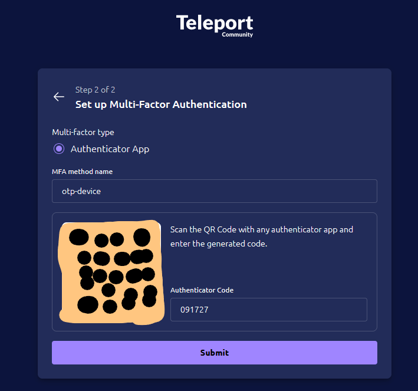

# Installation de Teleport


---

> [!note] "Informations"
>
> - **Auteur :** Louis MEDO
> - **Date :** 16/11/2026
> - **Domaine :** Debian

---

## 1. Sommaire

- [1. Sommaire](#1-sommaire)
- [2. Contexte](#2-contexte)
- [3. Préparation du système](#3-préparation-du-système)
- [4. Installation du binaire Teleport](#4-installation-du-binaire-teleport)
- [5. Configuration automatisée de Teleport](#5-configuration-automatisée-de-teleport)
- [6. Initialisation et post-configuration](#6-initialisation-et-post-configuration)

## 2. Contexte

Déploiement du service Teleport jouant le rôle de Bastion d'infrastructure pour l'environnement ECOCERT. Ce composant centralise, sécurise et audite les accès aux ressources (serveurs, bases de données, clusters Kubernetes). Il est intégré à l'infrastructure PKI interne (Step-CA) afin d'automatiser le provisionnement et le renouvellement de ses certificats TLS via le protocole ACME, garantissant ainsi un chiffrement de bout en bout sans aucune intervention manuelle.

## 3. Préparation du système

3.1. **Mise à jour des dépôts et des paquets.** Il est impératif de s'assurer que le système Debian dispose des derniers correctifs de sécurité avant d'installer un composant de sécurité critique tel qu'un bastion.

```bash
sudo apt update && sudo apt upgrade -y
```

* `update` : Met à jour la liste des paquets disponibles et leurs versions.
* `upgrade -y` : Installe les nouvelles versions des paquets sans demander de confirmation.

## 4. Installation du binaire Teleport

4.1. **Téléchargement et exécution du script d'installation.** L'utilisation du script officiel garantit l'ajout des bons dépôts et le déploiement de la version spécifique ciblée en évitant les dérives de configuration.

```bash
curl https://cdn.teleport.dev/install.sh | bash -s "18.11.10" "oss"
```

* `https://cdn.teleport.dev/install.sh` : URL du script de provisionnement officiel de Teleport.
* `"18.11.10"` : Version exacte de Teleport à installer pour garantir l'immutabilité et la prédictibilité du déploiement.
* `"oss"` : Édition Open Source (Community).

4.2. **Vérification de l'installation.** Contrôle du bon déploiement du binaire et de sa version.

```bash
teleport version
```

* `version` : Affiche la version actuelle, le commit Git et la version de Go utilisée lors de la compilation.

> [!note] Résultat attendu
> La sortie de la commande doit ressembler à :
> `Teleport v18.11.10 git:v18.11.10-0-g3e50964c go1.26.10`

## 5. Configuration automatisée de Teleport

5.1. **Génération du fichier de configuration principal.** Création du fichier `/etc/teleport.yaml`. Les blocs de configuration statiques pour les certificats HTTPS ont été remplacés par une configuration ACME afin de s'interfacer automatiquement avec l'autorité de certification interne Step-CA.

```bash
sudoedit /etc/teleport.yaml
```

```config
#
# A Sample Teleport configuration file.
#
# Things to update:
#  1. license.pem: Retrieve a license from your Teleport account https://teleport.sh
#     if you are an Enterprise customer.
#
version: v3
teleport:
  nodename: bastion.ecocert4.fr
  data_dir: /var/lib/teleport
  join_params:
    token_name: ""
    method: token
  log:
    output: stderr
    severity: INFO
    format:
      output: text
  ca_pin: ""
  diag_addr: ""
auth_service:
  enabled: "yes"
  listen_addr: 0.0.0.0:3025
  proxy_listener_mode: multiplex
ssh_service:
  enabled: "no"
proxy_service:
  enabled: "yes"
  web_listen_addr: 0.0.0.0:443
  public_addr: ['bastion.ecocert4.fr:443']
  acme:
    enabled: "yes"
    uri: "https://pki.ecocert4.fr/acme/acme/directory"
```

* `tee /etc/teleport.yaml` : Permet d'écrire le flux standard dans le fichier système protégé, en bénéficiant de l'élévation de privilèges via `sudo`.
* `uri` : Point de terminaison du répertoire ACME du serveur Step-CA pour la délivrance des certificats.

## 6. Initialisation et post-configuration

6.1. **Démarrage et activation du service Teleport.** Configuration de Systemd pour exécuter et maintenir le daemon en fonctionnement.

```bash
sudo systemctl enable --now teleport
```

* `enable` : Configure le service pour qu'il démarre automatiquement au boot du système.
* `--now` : Lance le service immédiatement.

6.2. **Création de l'utilisateur d'administration par défaut.** Instanciation du premier compte local sur le cluster Teleport avec les droits d'accès requis.

```bash
sudo tctl users add january --roles=editor,access --logins=january
```

* `users add january` : Demande à l'utilitaire d'administration `tctl` de créer un nouvel utilisateur nommé `january`.
* `--roles=editor,access` : Assigne les rôles internes Teleport pour la gestion de la configuration (`editor`) et la connexion aux ressources (`access`).
* `--logins=january` : Définit le compte système cible (login SSH) autorisé lors des connexions via le Bastion.

6.3. **Accéder à la page de connexion.** Utilisez le lien d'invitation fourni lors de la création de l'utilisateur pour configurer le mot de passe ainsi que la MFA.

**Configuration du mot de passe :**



**Configuration de la MFA :**

Utilisez une application comme Proton Authentification, Google Authenticator etc...


