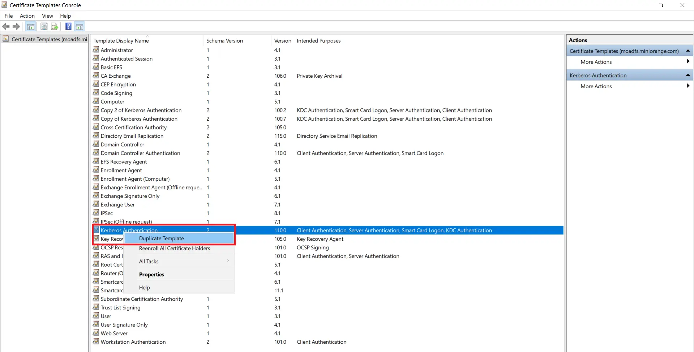
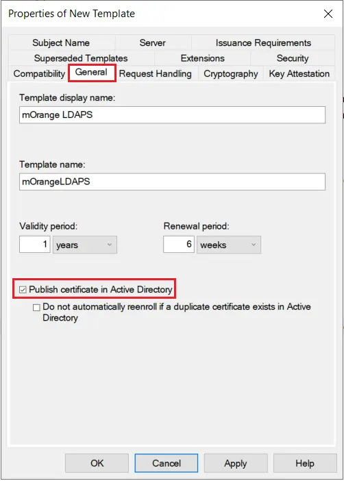
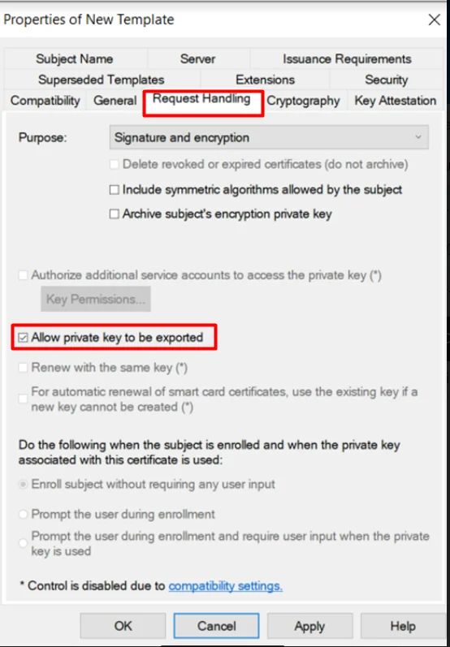
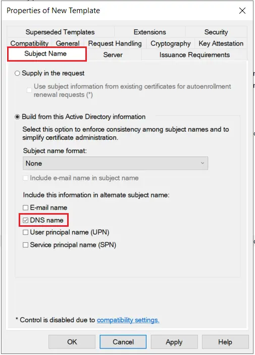

# Configuration et intégration LDAPS sur Windows Server 2025 (Expérience de bureau) et GLPI


---

!!! note "Informations"

    - **Auteur :** Amine KADA
    - **Date :** 12/10/2026
    - **Domaine :** Windows Serveur 2025 / Expérience de bureau (GUI)

---

## 1. Sommaire

- [1. Sommaire](#1-sommaire)
- [2. Contexte](#2-contexte)
- [3. Prérequis et matrice d'adressage](#3-prerequis-et-matrice-dadressage)
- [4. Validation de l'infrastructure Active Directory existante](#4-validation-de-linfrastructure-active-directory-existante)
- [5. Installation et configuration de l'autorité de certification (AD CS)](#5-installation-et-configuration-de-lautorite-de-certification-ad-cs)
- [6. Modèle de certificat serveur et inscription automatique](#6-modele-de-certificat-serveur-et-inscription-automatique)
- [7. Validation LDAPS locale et export du certificat CA racine](#7-validation-ldaps-locale-et-export-du-certificat-ca-racine)
- [8. Création des objets Active Directory (Comptes de service et test)](#8-creation-des-objets-active-directory-comptes-de-service-et-test)
- [9. Intégration du certificat et validation OpenLDAP sur le serveur GLPI](#9-integration-du-certificat-et-validation-openldap-sur-le-serveur-glpi)
- [10. Tests et Validation (Recette)](#10-tests-et-validation-recette)
- [11. Plan de Retour Arrière (Rollback)](#11-plan-de-retour-arriere-rollback)

---

## 2. Contexte

La présente procédure détaille l'implémentation d'une infrastructure d'authentification centralisée et sécurisée via LDAPS (LDAP over SSL - port TCP 636) entre un contrôleur de domaine Windows Server 2025 avec interface graphique (Expérience de bureau) et un serveur d'inventaire GLPI hébergé sous Debian Linux.

Sous Windows Server 2025, la signature LDAP est requise par défaut et le *Channel Binding* renforce les exigences d'intégrité, rendant l'usage de sessions non chiffrées (port TCP 389) obsolète et non sécurisé. Le déploiement s'articule autour d'une autorité de certification d'entreprise racine (AD CS) interne permettant d'émettre un certificat x509 conforme pour le contrôleur de domaine, de l'export de la chaîne de confiance vers le serveur Linux de GLPI, puis de la validation de la liaison sécurisée.

---

## 3. Prérequis et matrice d'adressage

| Rôle / Équipement | Nom d'hôte (FQDN) | OS | Rôle réseau / Port |
| :--- | :--- | :--- | :--- |
| Contrôleur de domaine & CA | `adecocert.local.ecocert4.fr` | Windows Server 2025 (GUI) | AD DS, DNS, AD CS (TCP/636, TCP/53) |
| Serveur GLPI | `glpiecocert.local.ecocert4.fr` | Debian 12 | Apache / PHP / GLPI (TCP/80, TCP/443) |

> [!note] Environnement de production existant
> Le domaine `local.ecocert4.fr` et le contrôleur de domaine `adecocert` sont déjà en production. L'autorité de certification d'entreprise (AD CS) est déployée sur le serveur existant pour activer automatiquement le LDAPS sans perturber les services d'annuaire en cours.

---

## 4. Validation de l'infrastructure Active Directory existante

4.1. **Vérification de l'état du domaine.** S'assurer que le contrôleur de domaine existant est opérationnel et que l'annuaire `local.ecocert4.fr` est joignable avant le déploiement du rôle AD CS.

Depuis la console *Utilisateurs et ordinateurs Active Directory* (`dsa.msc`) ou via PowerShell :

```powershell title="PowerShell (Admin)"
Get-ADDomain -Identity "local.ecocert4.fr"
```

- `Get-ADDomain` : Valide la présence, le niveau fonctionnel et la disponibilité du domaine existant `local.ecocert4.fr`.

---

## 5. Installation et configuration de l'autorité de certification (AD CS)

5.1. **Déploiement du rôle d'autorité de certification (AD CS).** Installer le rôle Services de certificats Active Directory avec les outils d'administration graphique (RSAT).

Depuis l'interface graphique :
1. Ouvrir le **Gestionnaire de serveur** > **Gérer** > **Ajouter des rôles et fonctionnalités**.
2. Choisir **Installation basée sur un rôle ou une fonctionnalité**.
3. Sélectionner le serveur local dans le pool de serveurs.
4. Cocher le rôle **Services de certificats Active Directory (AD CS)** et valider l'ajout des outils de gestion.
5. Dans les services de rôle, sélectionner **Autorité de certification**.
6. Confirmer et procéder à l'installation.

*(Alternative en ligne de commande PowerShell)* :

```powershell title="PowerShell (Admin)"
Install-WindowsFeature ADCS-Cert-Authority -IncludeManagementTools
```

- `Install-WindowsFeature` : Déploie le rôle d'autorité de certification ainsi que les consoles MMC associées (`certsrv.msc`).

5.2. **Configuration de l'autorité d'entreprise racine.** Configurer l'autorité de certification pour l'intégrer au domaine Active Directory.

Depuis l'interface graphique :
1. Dans le **Gestionnaire de serveur**, cliquer sur le drapeau d'alerte > **Configurer les services de certificats Active Directory**.
2. Spécifier les identifiants d'administrateur de domaine (`ECOCERT4\Administrateur`).
3. Cocher le service de rôle **Autorité de certification**.
4. Sélectionner **Autorité de certification d'entreprise** (*Enterprise CA*).
5. Sélectionner **Autorité de certification racine** (*Root CA*).
6. Choisir **Créer une nouvelle clé privée** (Fournisseur : RSA, Longueur : 4096 bits, Hachage : SHA256).
7. Nom de la CA : `Ecocert-Root-CA`.
8. Période de validité : **10 ans**.
9. Valider et terminer la configuration.

*(Alternative en ligne de commande PowerShell)* :

```powershell title="PowerShell (Admin)"
Install-AdcsCertificationAuthority -CAType EnterpriseRootCA `
  -CACommonName "Ecocert-Root-CA" `
  -CryptoProviderName "RSA#Microsoft Software Key Storage Provider" `
  -KeyLength 4096 -HashAlgorithmName SHA256 `
  -ValidityPeriod Years -ValidityPeriodUnits 10 -Force
```

- `-CAType EnterpriseRootCA` : Instancie une autorité d'entreprise directement rattachée et approuvée par la forêt Active Directory.
- `-KeyLength 4096` : Définit une clé de chiffrement robuste (4096 bits) pour le certificat racine.

5.3. **Validation du statut opérationnel de la CA.** Contrôler le service et l'état de l'autorité de certification.

```powershell title="PowerShell (Admin)"
Get-Service CertSvc
certutil -cainfo
```

- `Get-Service CertSvc` : Confirme que le service de certificats est à l'état `Running`.
- `certutil -cainfo` : Affiche l'arborescence et l'état des certificats de l'autorité locale.

---

## 6. Modèle de certificat serveur et inscription automatique

6.1. **Création du modèle de certificat LDAPS.** Exécuter la console de gestion des modèles (`certtmpl.msc`) :

- Dupliquer le modèle existant **Authentification Kerberos**.



- **Onglet Compatibilité :** Autorité de certification et Destinataire du certificat définis sur **Windows Server 2016**.
- **Onglet Général :** Nom complet défini sur `LDAPS-DC`, période de validité de **1 an**, période de renouvellement à **6 semaines**. Cocher **Publier le certificat dans Active Directory**.



- **Onglet Traitement de la demande :** Laisser **Autoriser l'exportation de la clé privée** coché.



- **Onglet Nom du sujet :** Choisir **Construire à partir de ces informations Active Directory**, Format du nom du sujet sur **Nom DNS**, et cocher **Nom DNS** en nom alternatif (SAN).



- **Onglet Sécurité :** Ajouter le groupe **Contrôleurs de domaine** et lui attribuer les droits **Lecture**, **Inscription** et **Inscription automatique**.

6.2. **Publication du modèle sur l'autorité de certification.** Ouvrir la console `certsrv.msc` :
- Développer le nœud de l'autorité **Ecocert-Root-CA**.
- Effectuer un clic droit sur **Modèles de certificats** > **Nouveau** > **Modèle de certificat à délivrer**.
- Sélectionner le modèle `LDAPS-DC` et valider par **OK**.

6.3. **Configuration de l'auto-inscription via stratégie de groupe (GPO).** Déployer la stratégie d'inscription automatique pour les contrôleurs de domaine :
- Ouvrir la console `gpmc.msc` et éditer la GPO **Default Domain Controllers Policy**.
- Naviguer dans : `Configuration ordinateur` > `Stratégies` > `Paramètres Windows` > `Paramètres de sécurité` > `Stratégies de clé publique`.
- Activer la stratégie **Client des services de certificats - Inscription automatique** en cochant les deux options :
  - *Renouveler les certificats arrivés à expiration, suspendre les certificats en attente et supprimer les certificats révoqués*.
  - *Mettre à jour les certificats qui utilisent des modèles de certificats*.

6.4. **Application de la GPO et émission du certificat.** Déclencher la mise à jour des stratégies locales et forcer l'impulsion de synchronisation des certificats.

```powershell title="PowerShell (Admin)"
gpupdate /force
certutil -pulse
```

- `gpupdate /force` : Rafraîchit immédiatement l'ensemble des stratégies Active Directory appliquées à la machine.
- `certutil -pulse` : Déclenche l'inscription automatique des certificats basée sur les modèles assignés.

---

## 7. Validation LDAPS locale et export du certificat CA racine

7.1. **Test de l'écoute du port sécurisé LDAPS.** S'assurer de l'ouverture du socket TCP sur le port 636.

```powershell title="PowerShell (Admin)"
Test-NetConnection adecocert.local.ecocert4.fr -Port 636
```

- `-Port 636` : Port d'écoute standard dédié au protocole LDAPS (LDAP over TLS/SSL).

7.2. **Validation locale de la session SSL avec ldp.exe.** 
- Exécuter la commande `ldp.exe`.
- Naviguer dans le menu **Connexion** > **Connecter**.
- Saisir `adecocert.local.ecocert4.fr` sur le port `636` en cochant la case **SSL**.
- Confirmer l'établissement de la session : la console doit afficher `Established connection to adecocert.local.ecocert4.fr`.

7.3. **Exportation du certificat x509 de l'autorité racine.** 
- Ouvrir la console `certsrv.msc`.
- Clic droit sur **Ecocert-Root-CA** > **Propriétés** > **Général** > **Afficher le certificat**.
- Dans l'onglet **Détails**, cliquer sur **Copier dans un fichier**.
- Sélectionner le format **X.509 codé en base 64 (.CER)** et enregistrer le fichier sous `C:\ecocert-root-ca.cer`.

---

## 8. Création des objets Active Directory (Comptes de service et test)

8.1. **Provisionnement des unités d'organisation et des comptes via PowerShell.** Créer l'arborescence, le compte de liaison pour GLPI et l'utilisateur de validation technique (ou via la console graphique *Utilisateurs et ordinateurs Active Directory* `dsa.msc`).

```powershell title="PowerShell (Admin)"
New-ADOrganizationalUnit -Name "Services" -Path "DC=local,DC=ecocert4,DC=fr"
New-ADOrganizationalUnit -Name "Utilisateurs" -Path "DC=local,DC=ecocert4,DC=fr"

New-ADUser -Name "svc_glpi" -SamAccountName "svc_glpi" `
  -UserPrincipalName "svc_glpi@local.ecocert4.fr" `
  -Path "OU=Services,DC=local,DC=ecocert4,DC=fr" `
  -AccountPassword (ConvertTo-SecureString "StrongPassword123!" -AsPlainText -Force) `
  -Enabled $true -PasswordNeverExpires $true

New-ADUser -Name "Jean Dupont" -GivenName "Jean" -Surname "Dupont" `
  -SamAccountName "jdupont" `
  -UserPrincipalName "jdupont@local.ecocert4.fr" `
  -EmailAddress "jdupont@local.ecocert4.fr" `
  -Path "OU=Utilisateurs,DC=local,DC=ecocert4,DC=fr" `
  -AccountPassword (ConvertTo-SecureString "ChangezMoiSVP@37ù" -AsPlainText -Force) `
  -Enabled $true
```

- `svc_glpi` : Compte de service dédié aux requêtes de lecture GLPI (aucun privilège d'administration requis).
- `jdupont` : Compte utilisateur standard rattaché à l'OU `Utilisateurs` pour le test d'authentification unitaire.

8.2. **Extraction du DistinguishedName (DN) du compte de service.**

```powershell title="PowerShell (Admin)"
(Get-ADUser svc_glpi).DistinguishedName
```

- Renvoie le chemin LDAP complet : `CN=svc_glpi,OU=Services,DC=local,DC=ecocert4,DC=fr`, nécessaire pour la configuration de GLPI.

---

## 9. Intégration du certificat et validation OpenLDAP sur le serveur GLPI

9.1. **Installation des extensions PHP et des utilitaires d'annuaire.** Installer les composants logiciels sur le serveur GLPI (Debian/Ubuntu).

```bash title="Terminal (serveur GLPI)"
sudo apt update
sudo apt install -y php-ldap php-bcmath ldap-utils openssl ca-certificates
```

- `php-ldap` : Module PHP indispensable pour activer le support de l'authentification externe LDAP/AD.
- `php-bcmath` : Extension mathématique requise par GLPI.
- `ldap-utils` : Paquet fournissant les utilitaires clients (`ldapsearch`).

9.2. **Résolution du nom d'hôte contrôleur de domaine.** Pour contourner l'interception mDNS des TLD `.local`, renseigner la correspondance IP/FQDN dans le fichier d'hôtes.

```bash title="/etc/hosts"
echo "172.16.54.1  adecocert.local.ecocert4.fr adecocert" | sudo tee -a /etc/hosts
getent hosts adecocert.local.ecocert4.fr
```

- `172.16.54.1` : Adresse IP fixe du contrôleur de domaine `adecocert.local.ecocert4.fr`.

9.3. **Déclaration de la CA racine dans le magasin de certificats Linux.**

```bash title="Terminal (serveur GLPI)"
# Copier le contenu PEM issu de C:\ecocert-root-ca.cer dans ca-root.crt
sudo nano /usr/local/share/ca-certificates/ecocert-root-ca.crt
sudo update-ca-certificates
```

> [!note] Validation du magasin de confiance
> La commande `update-ca-certificates` doit explicitement retourner la confirmation `1 added`. Le certificat émis est alors référencé dans `/etc/ssl/certs/ca-certificates.crt`.

9.4. **Configuration du client OpenLDAP.** Éditer le fichier `/etc/ldap/ldap.conf` pour imposer la validation stricte de l'autorité de certification.

```ini title="/etc/ldap/ldap.conf"
TLS_CACERT /etc/ssl/certs/ca-certificates.crt
TLS_REQCERT demand
```

- `TLS_CACERT` : Chemin d'accès au magasin unifié des certificats d'autorités de confiance.
- `TLS_REQCERT demand` : Exige un certificat valide émis par une autorité de confiance reconnue lors du handshake TLS.

9.5. **Validation unitaire de la négociation TLS et de la requête LDAP.**

```bash title="Terminal (serveur GLPI)"
openssl s_client -connect adecocert.local.ecocert4.fr:636 -verify_hostname adecocert.local.ecocert4.fr </dev/null 2>/dev/null | grep -Ei "verif|subject|issuer"
```

> Le retour doit impérativement afficher : `Verify return code: 0 (ok)`.

```bash title="Terminal (serveur GLPI)"
ldapsearch -x -H ldaps://adecocert.local.ecocert4.fr:636 \
  -D "CN=svc_glpi,OU=Services,DC=local,DC=ecocert4,DC=fr" \
  -w "StrongPassword123!" \
  -b "DC=local,DC=ecocert4,DC=fr" "(sAMAccountName=jdupont)" dn
```

- `-x` : Utilise l'authentification simple (Simple Bind) au lieu de SASL.
- `-H ldaps://...` : Cible l'URI LDAPS chiffrée sur le port 636.
- `-D` : Distinguished Name (DN) du compte de liaison.

9.6. **Redémarrage des services web.**

```bash title="Terminal (serveur GLPI)"
sudo systemctl restart apache2
```

---

## 10. Tests et Validation (Recette)

- [ ] Le port 636 est bien à l'écoute sur le contrôleur de domaine (`Test-NetConnection -Port 636` ou `netstat -ano | findstr 636`).
- [ ] La résolution DNS du FQDN du contrôleur fonctionne depuis les machines clientes.
- [ ] La commande `openssl s_client` renvoie `Verify return code: 0 (ok)`.
- [ ] La requête `ldapsearch` via `ldaps://` renvoie bien le DN de l'utilisateur de test `jdupont`.

---

## 11. Plan de Retour Arrière (Rollback)

En cas de problème avec l'autorité de certification ou les certificats :
1. **Restauration de snapshot** : Revenir au snapshot Proxmox précédant l'installation du rôle AD CS.
2. **Désinstallation du rôle** : Supprimer le rôle AD CS via le Gestionnaire de serveur et redémarrer la machine.
