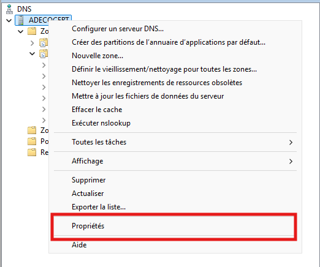
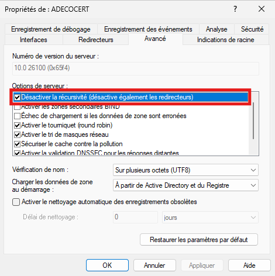
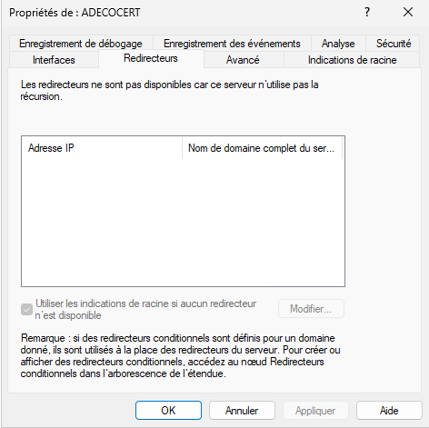

# Désactiver la récursivité DNS Windows


---

> [!note] "Informations"
>
> - **Auteur :** Louis MEDO
> - **Date :** 16/11/2026
> - **Domaine :** Windows

---

## 1. Sommaire

- [1. Sommaire](#1-sommaire)
- [2. Contexte](#2-contexte)
- [3. Procédure de désactivation (Interface Graphique)](#3-procedure-de-desactivation-interface-graphique)
- [4. Procédure de désactivation (PowerShell)](#4-procedure-de-desactivation-powershell)

## 2. Contexte

Ce document décrit la procédure de désactivation de la récursivité sur un serveur DNS Windows. Dans un standard d'ingénierie SRE et de sécurité, un serveur DNS autoritaire ne doit pas résoudre les requêtes externes pour éviter les attaques par amplification DNS (DDoS) et l'empoisonnement de cache.

> [!warning] "Impact de configuration"
> La désactivation de la récursivité empêche le serveur de transférer les requêtes non résolues. Cette action désactive et supprime automatiquement l'usage des redirecteurs.

## 3. Procédure de désactivation (Interface Graphique) {#3-procedure-de-desactivation-interface-graphique}

3.1. **Ouverture du gestionnaire DNS et accès aux propriétés.** Ouvrir la console de gestion DNS, effectuer un clic droit sur le nom du serveur DNS concerné, puis sélectionner **Propriétés** dans le menu contextuel.



3.2. **Modification des paramètres avancés.** Se rendre dans l'onglet **Avancé**. Dans les options du serveur, cocher la case **Désactiver la récursivité (désactive également les redirecteurs)**, puis valider avec **Appliquer**.



3.3. **Suppression et vérification des redirecteurs.** Basculer sur l'onglet **Redirecteurs** pour confirmer que la fonctionnalité est bloquée et que les anciens redirecteurs sont bien désactivés par le système.



## 4. Procédure de désactivation (PowerShell) {#4-procedure-de-desactivation-powershell}

4.1. **Désactivation de la récursivité avec PowerShell.**

```powershell title="disable_dns_recursion.ps1"
Set-DnsServerRecursion -Enable $false
```

- `Set-DnsServerRecursion` : Cmdlet Windows Server modifiant les propriétés de récursivité du service DNS local.
- `-Enable` : Paramètre déterminant l'état d'activation de la récursivité.
- `$false` : Valeur booléenne passée au paramètre pour forcer la désactivation de la fonctionnalité.
